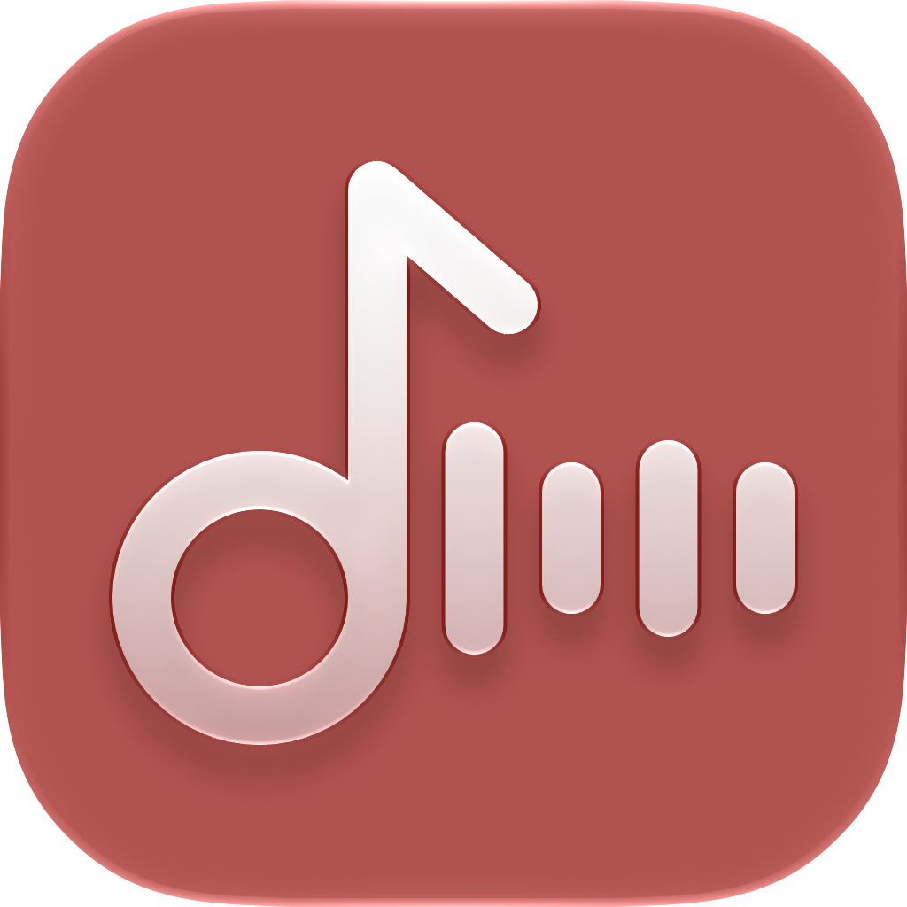

 

# Eigenton

Eigenton is an iOS/iPadOS/macOS app written in Swift to play music from an [Ampache](http://ampache.github.io) or [Subsonic](http://www.subsonic.org) server.

It is an independent fork of [Amperfy](https://github.com/BLeeEZ/amperfy) by Maximilian Bauer and its contributors, and continues development in its own direction: UI refinements, behavior changes, new features and a simpler app with fewer features.

Eigenton is not affiliated with the Amperfy project. Please report issues [here](https://github.com/chrizzchrizz/eigenton/issues), not upstream. The original Amperfy is available on the [App Store](https://apps.apple.com/app/amperfy-music/id1530145038).

## Features

- Multi account
- Offline mode
- CarPlay
- Gapless playback for appropriate media file formats
- Music, Podcast and Radio support
- Siri play media command, Siri Shortcuts and App Intents
- Equalizer
- Replay gain
- Sleep timer
- 5 star song rating
- Favorite song
- Sleep Timer
- Scrobbling
- Continue playback on another device (play queue sync, Subsonic/Navidrome)

## Continue Playback

Start listening on one device and continue on another one: the play queue, the current song and its position are saved on the server and can be loaded on another device.

**Setup** (on every device): Settings > Player > enable "Sync Play Queue" and give the device a name under "Device Name", e.g. "iPhone von Chrizz". Without a name the device type ("iPhone", "iPad", "Mac") is used.

**Usage**: tap the devices button on Home, choose "Continue Playback" in the player menu, or on Mac in the Controls menu. A confirmation shows the song, the device that saved the queue, the song count and when it was saved. Continuing replaces the current queue and starts at the saved position.

**Behavior**
- The queue is saved after a song change, on pause or stop, after the queue changed, every 30 seconds while playing and when the app moves to the background.
- The device you continue from keeps playing, it doesn't pause. Once it notices the queue was saved by another device (within about 2 minutes), it stops saving until you start playback on it again, so it doesn't overwrite the queue of the device you continued on.
- If both devices save, the last save wins.

**Limitations**
- Only Subsonic servers that store a play queue (API 1.12 or newer, e.g. Navidrome); not available for Ampache.
- Devices with the same name can't be told apart, give each device its own name.
- Only songs are saved, no podcasts or radios. A song queued twice continues at its first occurrence.
- Without the OpenSubsonic extension `formPost`, at most 200 songs around the current one are saved.

## Requirements

* Xcode 26, Swift 6

## Getting Started

1. Check out the project and, next to it, the AudioStreaming fork it uses as a local package:
  ```
  git clone https://github.com/chrizzchrizz/eigenton.git
  git clone https://github.com/chrizzchrizz/AudioStreaming.git
  cd eigenton
  ```

2. Open the `Amperfy.xcodeproj` file (project and scheme still carry the original name).

3. Build and run the "Amperfy" scheme

  >Real device testing: the CarPlay entitlement is removed in this fork. Siri support needs a developer certificate with granted access to `com.apple.developer.siri`; to test without it, clear the remaining entries in `Amperfy/Amperfy.entitlements`.

## Contribution

Issues and pull requests for this fork are welcome.

## Attributions

- [AudioStreaming](https://github.com/dimitris-c/AudioStreaming) by [Dimitris C.](https://github.com/dimitris-c) is licensed under [MIT License](https://github.com/dimitris-c/AudioStreaming/blob/main/LICENSE)
- [MarqueeLabel](https://github.com/cbpowell/MarqueeLabel) by [Charles Powell](https://github.com/cbpowell) is licensed under [MIT License](https://github.com/cbpowell/MarqueeLabel/blob/master/LICENSE)
- [ID3TagEditor](https://github.com/chicio/ID3TagEditor) by [Fabrizio Duroni](https://github.com/chicio) is licensed under [MIT License](https://github.com/chicio/ID3TagEditor/blob/master/LICENSE.md)
- [CoreDataMigrationRevised-Example](https://github.com/wibosco/CoreDataMigrationRevised-Example) by [William Boles](https://github.com/wibosco) is licensed under [MIT License](https://github.com/wibosco/CoreDataMigrationRevised-Example/blob/master/LICENSE)
- [VYPlayIndicator](https://github.com/obrhoff/VYPlayIndicator) by [Dennis Oberhoff](https://github.com/obrhoff) is licensed under [MIT License](https://github.com/obrhoff/VYPlayIndicator/blob/master/LICENSE)
- [CallbackURLKit](https://github.com/phimage/CallbackURLKit) by [Eric Marchand](https://github.com/phimage) is licensed under [MIT License](https://github.com/phimage/CallbackURLKit/blob/master/LICENSE)
- [Alamofire](https://github.com/Alamofire/Alamofire) by [Alamofire](https://github.com/Alamofire) is licensed under [MIT License](https://github.com/Alamofire/Alamofire/blob/master/LICENSE)
- [Ifrit](https://github.com/ukushu/Ifrit) by [Andrii Vynnychenko](https://github.com/ukushu) is licensed under [MIT License](https://github.com/ukushu/Ifrit/blob/main/LICENSE.md)
- [swift-collections](https://github.com/apple/swift-collections) by [Apple](https://github.com/apple) is licensed under [Apache License 2.0](https://github.com/apple/swift-collections/blob/main/LICENSE.txt)
- [iOS-swiftUI-spotify-equalizer](https://github.com/urvi-k/iOS-swiftUI-spotify-equalizer) by [urvi koladiya](https://github.com/urvi-k) is licensed under [MIT License](https://github.com/urvi-k/iOS-swiftUI-spotify-equalizer/blob/main/LICENSE)

**License:** [GPLv3](LICENSE). Based on [Amperfy](https://github.com/BLeeEZ/amperfy), copyright © 2019-2026 Maximilian Bauer and contributors. Modifications copyright © 2026 Chrizz Gelbach.
